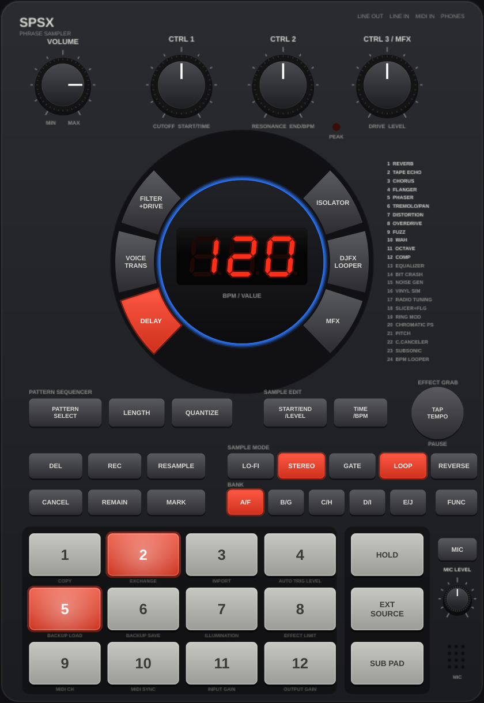

# SPSX

A recreation of a classic 2009 12-pad phrase sampler with a 7-segment display, built with JUCE as a macOS standalone app plus AU and VST3 plugins (Linux builds too). Authentic mode follows the hardware's behaviour and limits; Extended mode adds features for finishing songs.



Status: preview. See `docs/PROGRESS.md` for the current phase and `docs/PLAN.md` for the roadmap.

## Download
Builds are attached to [GitHub Releases](../../releases). Install notes are in `docs/RELEASE_NOTES.md`.

## Build
```bash
cmake -S . -B build -G Ninja -DCMAKE_BUILD_TYPE=Release
cmake --build build --parallel
ctest --test-dir build --output-on-failure
```
Add `-DSPSX_UNIVERSAL=ON` on macOS for an arm64 + x86_64 build, or use `-G Xcode`. Dependencies (JUCE, signalsmith-stretch, Catch2) are fetched at pinned versions; see `THIRD_PARTY.md`.

## Releasing
Bump `project(SPSX VERSION x.y.z)` in `CMakeLists.txt`, update `docs/RELEASE_NOTES.md`, then either push a tag `vx.y.z` or run the workflow manually (Actions > Build, test and release > Run workflow) with `release_tag` set to `vx.y.z`. CI builds, tests, validates with pluginval (strictness 10) and auval, and publishes the release. Versions below 1.0 and tags with a suffix (`v1.0.0-beta1`) are marked as pre-releases.

## Docs
`docs/SPEC.md` (hardware behaviour), `docs/ARCHITECTURE.md`, `docs/FIDELITY.md`, `CLAUDE.md` (contributor and agent notes).
